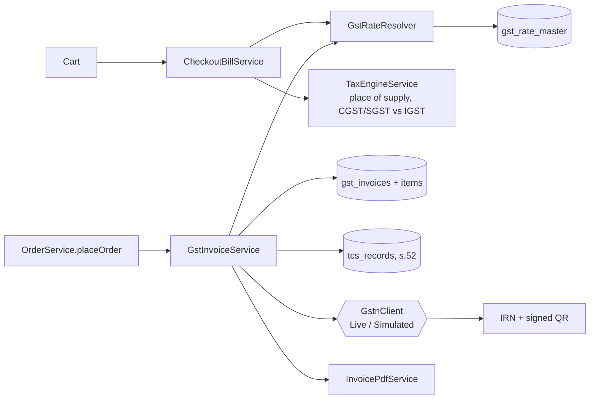
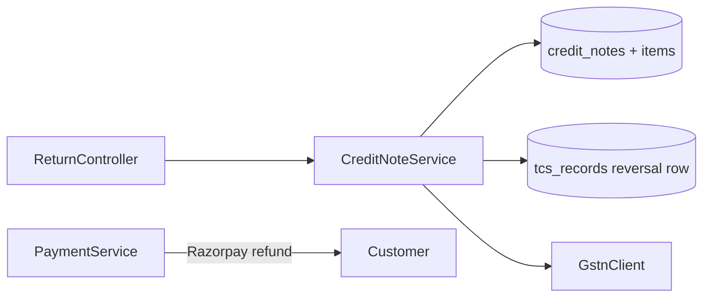
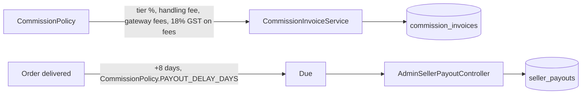
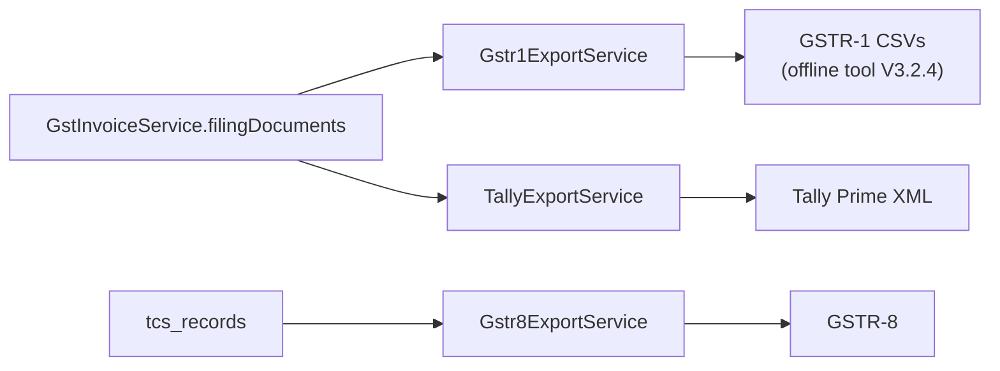
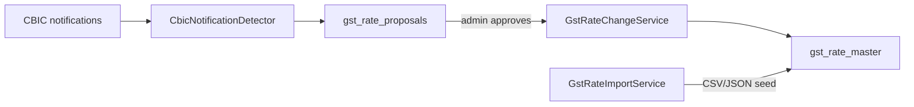
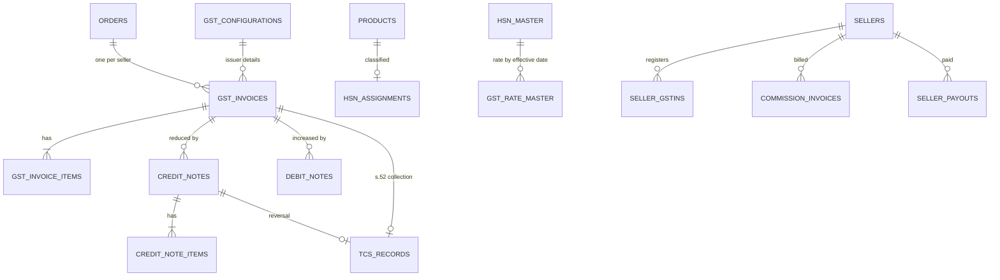

# GST platform — Phase 1 discovery audit

Date: 1 Nov 2026 · Branch `gst-taxinformation-portal` · Nothing removed or changed by this audit.

This is the Phase 1 deliverable of the "Enterprise GST Compliance Platform" brief. The brief's
first rule is that nothing is deleted until a full dependency analysis exists; this is that
analysis, followed by a gap check against the brief's 17 phases and a recommended migration path.

## 1. Summary

- The existing GST system is not a thin or hardcoded layer. It is ~15,000 lines across 37
  services, 11 controllers (~135 endpoints) and ~30 tables, and it already covers most of what
  the brief asks for: one rate resolver with no hardcoded product rates, a versioned rate master
  fed from CBIC notifications with admin approval, HSN/SAC masters, Rule 46 invoices, credit and
  debit notes, s.52 TCS records, GSTR-1/GSTR-8 exports that match the official offline tools,
  an NIC e-invoice client (IRN/QR, currently simulated), Tally export and seller payouts.
- **Deleting and rebuilding it would throw away verified, tested behaviour (655 passing tests)
  and put live invoicing at risk for no gain.** Recommended path: keep it, and close the gaps
  below in place (section 7).
- Biggest real gaps: Flyway is off (schema is managed by Hibernate `ddl-auto=update`), the audit
  log is mutable, no e-way bill, e-invoice not tested on the NIC sandbox, a few hardcoded
  fallbacks (18% SAC/commission fee, 0.5% TCS default), and no settlement ledger tying payout =
  sale − commission − GST on commission − TCS − gateway fees in one record.

## 2. Inventory

### Services (lines)

| Area | Services |
|---|---|
| Invoicing | GstInvoiceService 2037, InvoicePdfService 151, CheckoutBillService 232 |
| Notes | CreditNoteService 993, DebitNoteService 378 |
| Tax engine | GstRateResolver 376, TaxEngineService 154, TaxPreviewService 181, GstComplianceUtil 309, StateCodeUtil 74 |
| Rate master | GstRateAdminService 391, GstRateChangeService 413, GstRateImportService 304, GstRateFreshnessService 336, CbicNotificationDetector 504, GstRuleWatchService 444 |
| HSN | GstMasterDataLoader 977, HsnClassificationService 367, ProductTermMapper 238, ProductComplianceService 519 |
| Returns | Gstr1ExportService 550, Gstr8ExportService 160, TallyExportService 345 |
| GSTN / NIC | GstnClient (interface), LiveGstnClient 661, SimulatedGstnClient 181, GstSyncScheduler 44, GstinVerificationService 106 |
| Compliance | GstComplianceReadinessService 506, ComplianceService 359, ReconciliationService 140 |
| Marketplace | CommissionInvoiceService 387, CommissionPolicy 122, PaymentService 493, MarketplaceImportService 100 |
| Callers | OrderService 1317, ProductService 1211 |

### Tables

- Invoices: `gst_configurations`, `gst_invoices`, `gst_invoice_items`, `credit_notes`,
  `credit_note_items`, `debit_notes`, `debit_note_items`
- Rates: `gst_rate_master`, `gst_rate_proposals`, `gst_rate_sources`, `gst_rule_updates`, `gst_sync_queue`
- Masters: `hsn_master`, `hsn_assignments`, `sac_master`, `chapter_master`, `unit_master`,
  `state_master`, `trade_synonyms`, `product_compliance`
- Marketplace: `tcs_records`, `commission_invoices`, `commission_invoice_lines`,
  `commission_rates`, `seller_payouts`, `reconciliation_records`, `filing_deadlines`,
  `seller_gstins`, `seller_apobs`
- Audit: `audit_logs` (generic, via AuditService)

### API surface

| Controller | Base path | Endpoints |
|---|---|---|
| GstInvoiceController | /api/gst | 34 |
| GstComplianceController | /api/gst | 30 |
| AdminGstRateController | /api/admin/gst-rates | 18 |
| AdminGstReadinessController | /api/admin/gst | 11 |
| AdminCommissionController | /api/admin/commission | 10 |
| HsnController | /api/hsn | 10 |
| ProductComplianceController | /api/compliance | 9 |
| AdminGstRuleUpdateController | /api/admin/gst-rule-updates | 4 |
| AdminSellerPayoutController | /api/admin/payouts | 4 |
| CheckoutTaxController | /api/checkout | 2 |
| AdminAuditController | /api/admin/audit-logs | 2 |

Plus GST touch points in Order, Seller, SellerRegistration, AdminProduct and Return controllers.

### Scheduled jobs

| Job | When | Does |
|---|---|---|
| GstRateFreshnessService | 06:30 daily | flags rates past their review date |
| CbicNotificationDetector | 07:30 daily | finds new CBIC rate notifications, makes proposals |
| GstRuleWatchService | 07:45 daily | watches GSTN/CBIC rule updates |
| GstSyncScheduler | every 5 min + 02:00 | retries queued IRN/GSTN calls |
| PaymentService | scheduled | unclaimed refund check |

## 3. Flows

### Checkout → invoice → TCS

### Return / refund

### Settlement

### Filing

### Rate updates

## 4. Entity relationships (core)

## 5. Hardcoded values found

| Where | Value | Risk |
|---|---|---|
| CommissionPolicy:54 `FEE_GST = 0.18` | 18% on platform fees | Low: SAC 998599 is 18%, but should come from the rate master |
| CommissionInvoiceService:137 | 18.0 fallback | Low: only when SAC lookup fails |
| GstInvoiceService:203 | SAC fallback 18.0 | Low: delivery-charge SAC fallback |
| GstConfiguration / GstInvoice / TcsRecord / GstInvoiceService:622 | TCS 0.5 default | Medium: s.52 rate is statutory but should be a dated config row |
| GstInvoiceService:666 comment | "1% TCS" | Cosmetic: stale comment, code uses 0.5% |
| GstInvoiceService:670 | marketplace "NOYYAL" | Cosmetic: old brand name in TCS rows |
| GstComplianceUtil.determineReverseCharge | wrong RCM codes | None today (unused) — delete |

Product GST rates are **not** hardcoded: they all go through `GstRateResolver` and `gst_rate_master`.

## 6. Gap check against the 17 phases

| # | Phase | Exists today | Gap |
|---|---|---|---|
| 1 | Discovery audit | this document | — |
| 2 | Safe removal | — | Not recommended; see section 7. Only dead code to remove |
| 3 | Modular architecture | services split by area | Not separate modules/packages; acceptable as a monolith |
| 4 | Tax engine, no hardcoded rates | GstRateResolver + TaxEngineService | Move 18% fee GST and 0.5% TCS into dated config |
| 5 | HSN master, versioned | hsn_master, gst_rate_master with effective dates, proposals | Rate rows 3101 and 4012 for 1 Nov 2026 marked UNVERIFIED |
| 6 | E-invoice adapters | GstnClient, Live + Simulated, NIC schema 1.1, ship-to | Not tested on NIC sandbox; EcmGstin not sent; live creds not set |
| 7 | E-way bill | Was present but unsafe (see item 4 below) | Fixed: Rule 138 trigger, validity, portal bulk JSON, record-back. No direct EWB API (needs GSP credentials) |
| 8 | TCS s.52 | tcs_records, reversals, GSTR-8 export | TCS rate as dated config |
| 9 | Settlement engine | CommissionPolicy, commission invoices, seller_payouts | No single settlement ledger per order line |
| 10 | Reporting | GSTR-1 (all tables incl. Table 14), GSTR-8, Tally, readiness dashboard | HSN table does not net CN/DN; no GSTR-3B summary |
| 11 | Immutable audit | audit_logs via AuditService | Mutable table; no hash chain; no DB-level append-only |
| 12 | Seller dashboard | GstInvoices.jsx, seller pages | TCS/settlement statement view thin |
| 13 | Admin control center | AdminGstCompliance, rate admin, rule updates | Adequate |
| 14 | 20-table PostgreSQL schema | ~30 tables already | Names differ; renaming has cost and no benefit |
| 15 | Java 21, Redis, Kafka, Flyway, OpenAPI, Docker, K8s | Java 17, Redis, Spring Boot 3.2.5, Railway | Flyway **disabled**; no Kafka (not needed at this volume); no OpenAPI doc; Java 21 upgrade optional |
| 16 | Authoritative sources | CBIC/GSTN watchers, official offline-tool templates, NIC masters | — |
| 17 | 27 deliverables | many already exist (code, tests, exports) | Docs/runbooks missing |

## 7. Risk assessment

| Option | Risk | Why |
|---|---|---|
| Delete and rebuild | **High** | Live invoices, IRNs, credit notes and TCS rows reference current tables. A rebuild must reproduce every rule already verified (Rule 46 fields, place of supply, GSTR-1 formats, checksum fix) before going live, while legally numbered invoice series must continue unbroken. |
| Evolve in place | Low | Each gap is a contained change with its own tests. |
| Turn on Flyway naively | Medium | The live DB was built by `ddl-auto=update`; Flyway needs a baseline of the existing schema first, or V2–V6 will collide. |
| Kafka | Medium cost, no benefit | Order volume does not need a message broker; the existing `gst_sync_queue` + scheduler already gives retryable async IRN calls. |

## 8. Recommended migration strategy

No deletion. Close gaps in this order, one reviewable commit each:

1. **Flyway** — DONE (step 1 of 2): `FlywayAfterHibernateConfig` runs Flyway after Hibernate on PostgreSQL, baselined at V6, so V7+ run automatically. Rollback: `app.flyway.enabled=false`. Still to do: a `pg_dump --schema-only` baseline from live (owner) before switching `ddl-auto` to `validate`.
2. **Append-only audit** — DONE: `gst_audit_events` (V7) with a SHA-256 hash chain and a trigger refusing UPDATE/DELETE/TRUNCATE; written after commit for invoice issued, status change, IRN generated/failed, credit/debit note issued, rate change accepted, registration saved. Admin API: `GET /api/admin/gst/audit-events`, `/history`, `/verify`.
3. **Dated tax config** — DONE for TCS: `master-data/statutory_rates.json` + `StatutoryRates`, rate taken from the invoice date (1% to 9 Jul 2024, 0.5% from 10 Jul 2024); the configuration row no longer decides it. Left as is: `CommissionPolicy.FEE_GST` (an estimate of GST on Razorpay's fee, not a tax we charge) and the 18% commission fallback (live config may have no commission rate). Dead `determineReverseCharge` removed.
4. **E-way bill** — DONE. Correction to section 6: it was not missing but unsafe - the trigger used taxable value, the simulator printed made-up "EWB..." numbers on real invoices, and the live client threw on every order over ₹50,000. Now: `EwayBillService` decides by consignment value (value + tax, goods only, exempt left out; threshold dated in `statutory_rates.json`), Rule 138(10) validity, invoice `ewayBillStatus` NOT_REQUIRED/REQUIRED/GENERATED, the portal's bulk-generation JSON (`GET /api/gst/ewaybill/bulk-json`), a pending list and number record-back (`POST /api/gst/invoices/{id}/ewaybill`, audited), and an "E-way bills" tab for sellers. The bulk JSON field names follow the EWB API; check one upload against the portal before relying on it.
5. **E-invoice hardening** — DONE in code, sandbox test still open. Found on the way: the retry queue (`processSyncQueue`) never called the IRP - it only relabelled rows - so an invoice whose IRN failed at checkout stayed unregistered. Now: real retries with doubling back-off (5 min to 1 day, 12 tries), no retry for refusals that need the data fixed; the 30-day reporting limit for AATO of ₹10 crore and above (dated in `statutory_rates.json`) fails clearly instead of retrying for ever; error 2150 (duplicate) recovers the existing IRN via Get-by-IRN; `EcmGstin` sent for marketplace sales; credit and debit notes against e-invoices are registered as CRN/DBN with `RefDtls.PrecDocDtls`, IRN printed on their PDFs. Still open: one end-to-end run on the NIC sandbox (needs the owner's sandbox credentials), and the signed QR image on note PDFs.
6. **Settlement ledger** — DONE as a statement worked out from existing records (orders, rate card, TCS records, payouts) rather than a new table, so it always agrees with the commission invoice and GSTR-8. Fixes the earlier preview, which left out GST on the marketplace's fees and TCS and so overstated every payout. Per order: sale, commission, handling fee, GST on fees, gateway and transfer fees, TCS (net of reversals), payable and payable-from date; per month: payable now, not yet payable, paid (non-voided payouts for that sales period) and balance due. `GET /api/seller/settlement?month=2026-10` for sellers, the admin `/api/admin/commission/settlement-preview` returns the same, and the seller Payouts page shows it.
7. **Reports** — net CN/DN in the HSN table; GSTR-3B summary.
8. **OpenAPI** — springdoc for the GST endpoints.

Backup before each step that touches the schema: Railway Postgres snapshot taken by the owner.

## 9. Before going live (independent of the above)

- Replace the demo marketplace registration (GSTIN 33ABCDE1234F1Z5, ₹60 crore turnover) at /admin/gst-compliance with the real one.
- Review the UNVERIFIED 1 Nov 2026 rate rows (HSN 3101, 4012).
- Set live NIC e-invoice credentials only when turnover crosses ₹5 crore.
