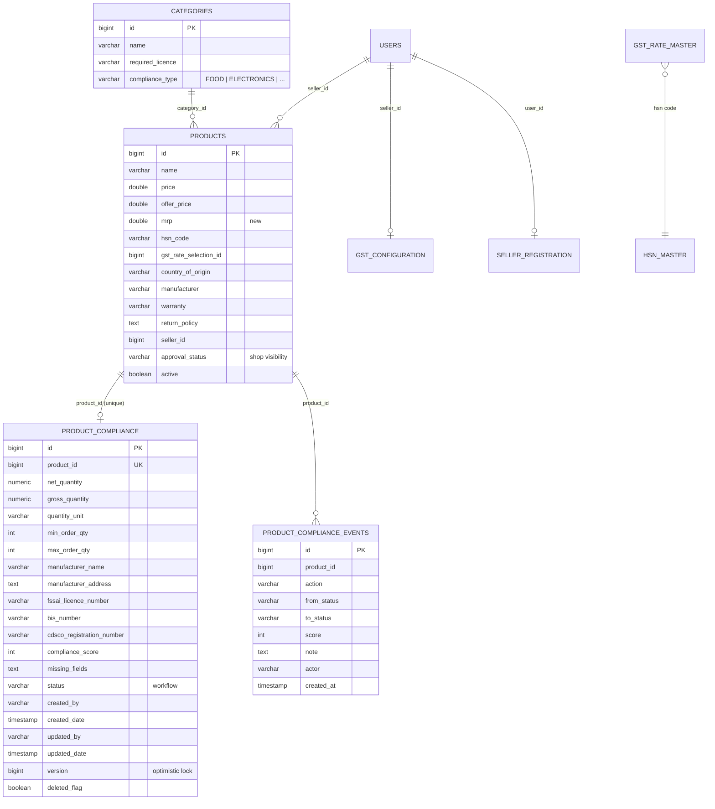
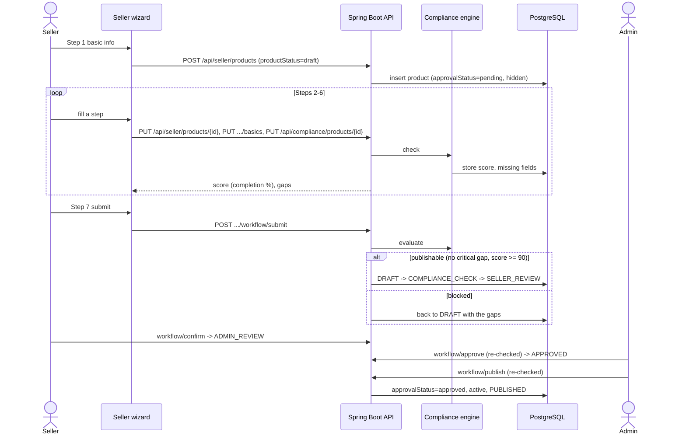

# Product catalogue compliance

How Cauvery Store makes sure every listing carries the data it must before shoppers can buy it,
how that is scored, who approves it, and what the customer sees.

- API reference: [openapi.yaml](openapi.yaml)
- Schema script (for review or a hand-run): `backend-java/src/main/resources/db/migration/V6__product_compliance.sql`

## 1. What is built

| Area | Where |
|---|---|
| Compliance record per product (Legal Metrology, order limits, manufacturer/packer/importer, origin, customer care, dates and batch, category fields), with audit columns | `ProductCompliance` entity, table `product_compliance` |
| Workflow history | `ProductComplianceEvent`, table `product_compliance_events` |
| MRP | `products.mrp` |
| Which category fields apply | `categories.compliance_type`: FOOD, ELECTRONICS, COSMETICS, MEDICAL, TOYS, CLOTHING, or none |
| Validators | `@ValidGstin`, `@ValidHsn`, `@ValidFssai`, `@ValidBis`, `@ValidCdsco` and `ComplianceFormats` |
| Engine and publish gate | `ProductComplianceService` |
| Workflow | `ProductComplianceWorkflowService` |
| API | `ProductComplianceController` (`/api/compliance`), `ProductLabelInfoController` (`/api/products/{id}/label-info`) |
| Admin screens | Product Compliance dashboard, per-product compliance page, compliance column on Product Approvals, compliance type on Categories |
| Seller screens | 7-step product wizard, Compliance button on each product |
| Shop | "Product information" block on the product page |

### Rules

**Score.** The score is the share of applicable checks that pass, rounded down, so any gap keeps it below 100.

| Score | Band | Effect |
|---|---|---|
| 100 | PUBLISHABLE | May be published |
| 90-99 | WARNING | May be published; the gaps are shown |
| below 90 | BLOCKED | Cannot be published |

**Critical gaps.** These block publishing whatever the score:
- GST: HSN missing, malformed or not in the GSTN master, or no published GST rate
- MRP or price missing, or price above MRP
- Manufacturer name or address
- Country of origin
- Legal Metrology net and gross quantity and unit
- The product's seller, the seller's GSTIN (format, check digit and state code), and a licence the category requires
- The category's own fields

**Common checks that only lower the score:**
- name, description, brand, SKU
- stock, min/max order quantity
- packer, or "packed by the manufacturer"
- state of origin for Indian goods; importer for imported goods
- customer care phone and email
- manufacturing date, batch or lot number
- seller business name and address

**Category fields** (all critical):

| Type | Fields |
|---|---|
| Food | FSSAI number (14 digits), ingredients, nutrition, allergens, veg/non-veg, storage, best-before or expiry |
| Electronics | warranty, service centre, BIS number, voltage, power |
| Cosmetics | ingredients, manufacturing licence, expiry date; batch becomes critical |
| Medical | CDSCO registration, prescription yes/no, warnings, disclaimer |
| Toys | BIS number, age group, safety warning |
| Clothing | fabric, wash care, size chart |

Only what the specification lists is enforced. Formats are checked; whether a number was really
issued is not, because no registry is queried. The CDSCO check is deliberately loose because those
numbers have no single published format.

### Reused, not rebuilt

- **GST rate:** `HsnClassificationService.assertSellable`, run on a throwaway copy, so publishing and scoring use one rule.
- **HSN existence:** `HsnClassificationService.describeCode`.
- **Licence-locked categories:** `ListingEligibilityService.checkCategory`.
- **Seller GSTIN:** looked up the way checkout does, GST configuration first and then registration.
- **GSTIN check digit:** `GstComplianceUtil.validateGstin`. The validator also requires a GSTN state code (01-38, 97 or 99). Checked against pocketgst.com's published rules.
- **Shop rate display:** `GstRateResolver.resolve`, the same resolver checkout uses.

## 2. Entity relationships



The full column list is in the V6 script. Compliance data lives in its own table, one row per
product. That keeps the `products` table, which every storefront query reads, narrow. The row is
created on first use, so products listed before this existed need no backfill.

## 3. Sequences

### Seller lists a product



### Publish gate on the older routes

```mermaid
sequenceDiagram
    actor Admin
    participant PA as Product Approvals / product form
    participant PS as ProductService
    participant E as Compliance engine

    Admin->>PA: Approve (or save as live)
    PA->>E: assertPublishable / holdIfNotPublishable
    alt publishable
        E-->>PS: ok
        PS-->>PA: saved; workflow marked PUBLISHED
    else not publishable
        E-->>PA: 409 with the full result (approval) or held at pending (save)
    end
```

## 4. Configuration

| Platform setting | Default | Meaning |
|---|---|---|
| `compliance.publish_gate` | on | `off` lets non-compliant products go on sale. This is an emergency switch only. |
| `compliance.enforce_live` | off | `on` also holds a live product that fails the check the next time anyone edits it. |

**Live products are scored, not hidden.** This is the agreed default: a product that was on sale
before this shipped stays on sale until someone turns on `enforce_live`.

## 5. Best practices

- Set each category's compliance type before sellers list in it. A category left as General asks only for the common fields.
- Use the dashboard's "On sale but blocked" view to clear old listings before turning on `enforce_live`.
- When an admin creates a product, it opens on its compliance page. A product is never "done" until that page shows 100, or 90-99 with every gap understood.
- Treat FSSAI, BIS and CDSCO numbers as format-checked only. For high-risk categories, ask for the certificate through the seller's licences (Store Profile > GST & Licences), which `ListingEligibilityService` already enforces per category.
- Bulk uploads have no compliance columns, so uploaded rows are held pending until their details are filled in.

## 6. Scaling

- **Dashboard load.** The dashboard checks every product live, looking each seller up once. This is fine for a few thousand products. Beyond that:
  - read the stored `compliance_score` and `missing_fields`, which are indexed by score and status;
  - page on the server;
  - refresh scores in a nightly job, and on save, which already happens.
- **Single-product cost.** One check costs a handful of indexed lookups: HSN master, GST rate master, seller registration and the licence list.
- **Compliance record writes.** These are rare, and optimistic locking (`version`) protects concurrent edits.
- **Public product block.** `label-info` is a read path on the product page. If traffic grows, cache it with the product cache (`products`), which is already evicted on product saves.

## 7. Security

- **Access.**
  - Every compliance endpoint needs a signed-in user.
  - Sellers are limited to their own products (`checkSellerOwnership`) and need `products.manage` when acting for a team.
  - Approve and publish are admin-only. A seller can only withdraw from their own review step.
- **Mass assignment.** Request bodies cannot set the workflow state, score, audit columns or record identity (`copyEditableFrom`). Product fields go through the normal product update, so a seller cannot approve their own listing or move it to another seller.
- **Public data.** The public `label-info` block exposes only what the specification lists for the product page. It never includes the seller's GSTIN, state or bank details. Listing cards and tiles show none of it.
- **Audit trail.** Every workflow step is recorded with its actor, and every compliance row carries created/updated by and date.
- **Deletion.** Records are soft-deleted (`deleted_flag`), never removed.
- **Payments.** Nothing here touches payments, keys or environment variables.

## 8. Roadmap

1. Nightly re-score job, and server-side paging for the dashboard (see Scaling).
2. Turn on `compliance.enforce_live` once the "On sale but blocked" list is clear.
3. Add compliance columns to the bulk-upload template, so sheets can arrive complete.
4. Enforce min/max order quantity in the cart and at checkout. Today it is stored and shown, but not enforced.
5. Show category-specific declarations (veg/non-veg mark, FSSAI number, expiry) on the product page where the business wants them.
6. Verify FSSAI, BIS and GSTIN against the issuing registries once an API or GSP contract exists.
7. Translate the product information labels. Today they fall back to English through i18n default values.

## 9. Known issue outside this work

`ProductService.withdrawFromSaleIfUntaxable` moves an untaxable product to `productStatus=draft`.
The storefront, however, decides visibility from `active` and `approvalStatus`, so the product
stays visible. Checkout still refuses to tax it. The compliance gate uses `approvalStatus`, so it
does hide products.
